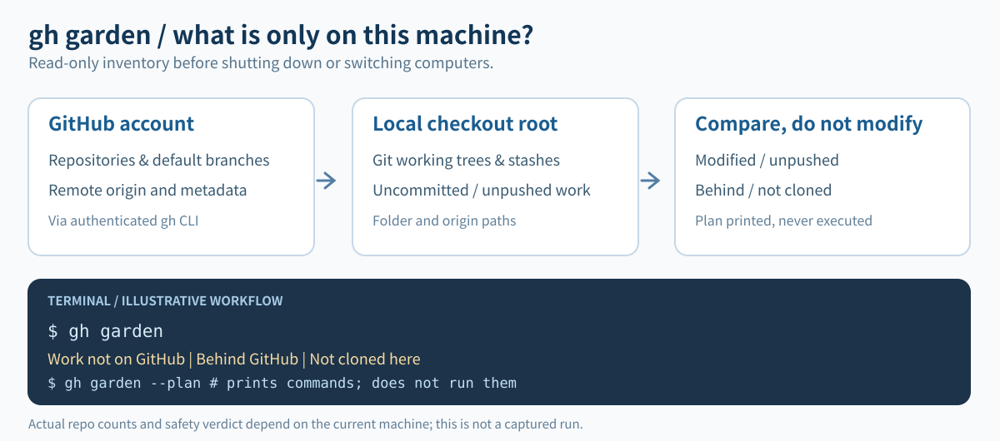

# gh garden

[](https://github.com/NaNIsaac/gh-garden/releases) [](https://github.com/NaNIsaac/gh-garden/actions/workflows/readme.yml) [](LICENSE)

**내 GitHub 계정과 내가 작업하는 컴퓨터들이 어디서 어긋나는지 보여 주는 도구. 저장하지 않은 작업, clone하지 않은 저장소, 엉뚱한 곳에 있는 폴더까지.**

[English](README.md)

`gh garden`은 저장소가 많고 컴퓨터가 여러 대인 사람을 위한 [GitHub CLI](https://cli.github.com/)
extension입니다. 내 계정이 접근할 수 있는 저장소를 나열하고, 이 컴퓨터의 한 폴더 아래에 있는 모든
git checkout을 찾아 `origin`으로 짝을 맞춘 다음, 두 쪽이 어긋나는 곳을 알려 줍니다.

이 도구가 답하려는 질문은 노트북을 덮기 전의 그것입니다. **이 컴퓨터를 떠나도 되나?** 이 컴퓨터의
저장소에 GitHub에 없는 수정, commit, stash가 있으면 답은 "안 된다"이고, 종료 코드도 그렇게 알려
줍니다.

## 하는 일

- **여기에만 있는 작업을 찾습니다.** 수정한 파일, push하지 않은 commit, stash를 저장소별로 보여
  줍니다.
- **여기에 없는 것을 찾습니다.** 이 컴퓨터가 한 번도 clone하지 않은 GitHub 저장소를 크기와 함께
  보여 줍니다.
- **어긋남을 찾습니다.** GitHub 기본 branch보다 뒤처졌거나 갈라진 로컬 branch, 옛 이름을 가리키는
  `origin`, `<root>/<owner>/<repo>`에 있지 않은 폴더.
- **고치는 명령을 출력만 하고 실행하지 않습니다.** `--plan`은 항목마다 `git`과 `gh` 명령을
  써 줍니다. 읽어 보고 원하는 것만 직접 실행합니다.
- **스크립트와 연결됩니다.** `--json`과 종료 코드는 hook과 스크립트에서 쓰도록 만들었습니다.
- **저장소로 바로 이동합니다.** `gh garden path qora`와 `gh garden open qora`는 GitHub를 호출하지
  않습니다.
- **원하면 다른 컴퓨터의 상태를 기억합니다.** 꺼 둔 컴퓨터도 secret gist에 메모를 남길 수 있습니다.
  요청할 때만 쓰고, 쓰기 전에 인증 정보가 섞였는지 검사합니다.

저장소는 절대 바꾸지 않습니다. fetch도, checkout도, commit도 없습니다. GitHub에 대해 아는 것은 전부
이미 로그인해 둔 `gh` CLI를 거쳐서 얻습니다.



*개념 설명용 SVG이며 실제 실험 데이터나 터미널 캡처가 아닙니다.*

## 설치

`PATH`에 `git`과 [`gh`](https://cli.github.com/)가 있고 `gh auth login`을 마친 상태여야 합니다.
Windows(x64)와 Linux(x64)를 지원하며 Rust는 필요 없습니다.

```
gh extension install NaNIsaac/gh-garden
git config --global garden.root D:/Projects
git config --global garden.machine lab
gh garden
```

`garden.root`는 clone을 모아 두는 폴더이고 `<root>/<owner>/<repo>` 구조여야 합니다.
`garden.machine`은 다른 컴퓨터에게 보이는 이 컴퓨터의 이름입니다. 갱신은
`gh extension upgrade garden`, 릴리스는 `v*` tag에서 나옵니다.

소스에서 설치: `cargo build --release`, 바이너리를 저장소 루트로 복사, `gh extension install .`.
다시 빌드하면 다시 복사해야 합니다. `gh`는 복사본을 실행합니다. 이 저장소의 clone 안에서 실행합니다.

<!-- test -->
```sh
cargo build --release
```

바이너리를 저장소 루트로 복사합니다.

<!-- test unix -->
```sh
cp target/release/gh-garden .
```

<!-- test windows -->
```powershell
Copy-Item target/release/gh-garden.exe .
```

<!-- test -->
```sh
gh extension install .
```

`gh`가 찾는지 확인합니다(못 찾으면 0이 아닌 코드로 끝납니다). `path`는 GitHub를 호출하지 않으므로
로그인 없이도 되고, `--root .`를 주면 지금 서 있는 clone을 나열합니다.

<!-- test -->
```sh
gh garden --help
```

<!-- test console -->
```console
$ gh garden path --root .
.
```

## 1. 퇴근 전: 이 컴퓨터를 꺼도 되나?

```
gh garden
```

```console
root  D:\Projects  (lab)

Work not on GitHub (2)
  NaNIsaac/clippath                    NaNIsaac\clippath            1 modified (on main)
  NaNIsaac/deai                        NaNIsaac\deai                1 unpushed commits (on main)
Only untracked files (1)
  NaNIsaac/roi_rectangle               NaNIsaac\roi_rectangle       1 untracked (on main)
Behind GitHub (1)
  NaNIsaac/hanfix                      NaNIsaac\hanfix              main: 1 behind
On GitHub, not cloned here (66)
  NaNIsaac/cohere                                                   fork, 1 MB
  NaNIsaac/cpython                                                  fork, 634 MB
  ...
Not at <root>/<owner>/<repo> (1)
  NaNIsaac/eml                         NaNIsaac\eml-old             expected NaNIsaac\eml
Local only (1)
  -                                    NaNIsaac\sketch              no origin remote
Not a git repo (under an owner folder) (1)
  -                                    NaNIsaac\scratch-notes

Synced: 1
NOT safe to leave this machine: 2 repo(s) have work that isn't on GitHub.
69 finding(s) have a fix: gh garden reconcile --plan
```

예시는 임시 폴더에서 실행한 출력이고, `...`로 표시한 곳만 줄였습니다. 섹션은 이 순서로 나오며
항목이 없는 섹션은 빠집니다. 마지막 판정은 세 줄 중 하나입니다.

- `Safe to leave this machine: everything here is on GitHub.`
- `Safe to leave this machine, unless N repo(s) hold untracked files you need.` untracked 파일은
  대개 빌드 부산물이지만 가끔 잊은 새 파일입니다. 어느 쪽인지는 본인만 압니다.
- `NOT safe to leave this machine: N repo(s) have work that isn't on GitHub.` 종료 코드는 2입니다.

나머지(behind, not cloned, misplaced)는 정리할 일일 뿐 판정을 바꾸지 않습니다.

자동으로 확인하려면 로그오프나 종료 hook에서 실행하고 종료 코드를 봅니다.

```sh
gh garden > /dev/null 2>&1
[ $? -eq 2 ] && echo "unsaved work: run gh garden"
```

```powershell
gh garden *> $null
if ($LASTEXITCODE -eq 2) { Write-Warning 'unsaved work: run gh garden' }
```

`git worktree` checkout이 여러 개인 저장소는 branch, commit, stash를 한 번만 셉니다(주 checkout이
보고합니다). worktree는 자기 폴더의 수정·untracked 파일만 보고합니다.

## 2. 새 PC 세팅: 전부 clone하기

새 컴퓨터에서는 모든 저장소가 "On GitHub, not cloned here"입니다. root를 정하고 plan을 요청합니다.

```
gh extension install NaNIsaac/gh-garden
git config --global garden.root D:/Projects
gh garden --plan
```

```
# For bash or PowerShell, not cmd.exe: arguments are single-quoted.
# On GitHub, not cloned here: NaNIsaac/QoraGeom 325 KB
gh repo clone 'NaNIsaac/QoraGeom' 'D:/Projects/NaNIsaac/QoraGeom'

# On GitHub, not cloned here: NaNIsaac/xarray fork, 53 MB
gh repo clone 'NaNIsaac/xarray' 'D:/Projects/NaNIsaac/xarray'
...
```

`--plan`은 출력만 합니다. 읽어 보고 원하는 것만 실행합니다. fork는 클 수 있으므로(`fork, 634 MB`는
GitHub가 보고하는 크기입니다) 텍스트 대신 JSON을 걸러서 건너뜁니다(PowerShell 7. Windows PowerShell
5.1은 `ConvertFrom-Json`에 배열을 객체 하나로 넘깁니다).

```powershell
gh garden --json | ConvertFrom-Json |
  Where-Object { $_.status -eq 'not_cloned' -and $_.detail -notlike 'fork*' } |
  ForEach-Object { Invoke-Expression $_.fix }
```

```sh
gh garden --json | jq -r '.[] | select(.status == "not_cloned" and (.detail | startswith("fork") | not)) | .fix' | sh
```

archived 저장소는 나오지 않습니다. clone은 `<root>/<owner>/<repo>`에 생기고, 다음 실행도 그 위치를
기대합니다.

## 3. 이름이 바뀐 저장소 정리하기

GitHub에서 저장소 이름을 바꾸면 옛 이름이 계속 redirect되어 한동안 문제없이 동작합니다. 자세히
보면 `origin`은 옛 이름이고 폴더도 옛 이름입니다. `gh garden`은 모르는 `origin`마다 GitHub에 지금
이름을 물어서 둘 다 보고합니다.

```
Renamed on GitHub, origin is stale (1)
  NaNIsaac/new-name                    NaNIsaac\old-name            origin still says NaNIsaac/old-name
Not at <root>/<owner>/<repo> (1)
  NaNIsaac/new-name                    NaNIsaac\old-name            expected NaNIsaac\new-name
```

```
gh garden --plan
```

```
# Renamed on GitHub, origin is stale: NaNIsaac/new-name origin still says NaNIsaac/old-name
git -C 'D:/Projects/NaNIsaac/old-name' remote set-url origin 'https://github.com/NaNIsaac/new-name.git'

# Not at <root>/<owner>/<repo>: NaNIsaac/new-name expected NaNIsaac\new-name
mv 'D:/Projects/NaNIsaac/old-name' 'D:/Projects/NaNIsaac/new-name'
```

출력된 순서대로 실행합니다. `mv`가 마지막이라야 `set-url` 줄이 아직 폴더를 찾습니다. `mv`는 목적지가
비어 있을 때만 나옵니다. 새 `origin`은 원래 `ssh`였더라도 `https://` URL로 씁니다.

같은 "예상 경로가 아님" 항목은 엉뚱한 owner 폴더나 다른 폴더 이름에 clone한 저장소도 잡습니다.
`origin`이 GitHub에 있지만 내 계정이 아닌 저장소(남의 저장소, 또는 이미 없어진 저장소)는 "Local
only"로 나오고 명령은 붙지 않습니다.

## 4. 스크립트로 쓰기: `--plan`, `--json`, 종료 코드

| 플래그 | 출력 | 비고 |
| --- | --- | --- |
| (없음) | 위의 보고서 | 다른 컴퓨터의 메모도 보여 줌 |
| `--plan` | 항목당 명령 하나 | 묶고 주석을 달며 실행은 안 함 |
| `--json` | 항목 배열 하나 | `synced`를 포함한 전부 |

`--plan`과 `--json`은 GitHub 메모를 건드리지 않고(읽지도 쓰지도 않습니다), 여기 작업이 저장되지
않았으면 똑같이 2로 끝납니다. JSON 항목은 아래 모양입니다. 안전한 명령이 없으면 `fix`가 없고,
clone하지 않은 저장소는 `path`가 `null`입니다.

```json
{
  "status": "unsaved",
  "repo": "NaNIsaac/deai",
  "path": "D:\\Projects\\NaNIsaac\\deai",
  "detail": "1 unpushed commits (on main)",
  "fix": "git -C 'D:/Projects/NaNIsaac/deai' push origin 'main'"
}
```

`status`는 `unsaved`, `untracked`, `diverged`, `behind`, `not_cloned`, `renamed`, `misplaced`,
`local_only`, `not_git`, `synced` 중 하나입니다([섹션](#섹션) 참고). 항목은 이 순서, 그다음 repo,
그다음 path로 정렬됩니다.

```powershell
# 여기에만 있는 작업이 든 저장소
gh garden --json | ConvertFrom-Json | Where-Object status -eq 'unsaved' | ForEach-Object repo
```

```sh
gh garden --json | jq -r '.[] | select(.status == "unsaved") | .repo'
```

종료 코드는 [참고 자료](#종료-코드)에 있습니다. 저장 안 된 것이 있으면 2로 끝나므로, `set -e` 아래에서
계속 가야 하는 스크립트는 `gh garden` 뒤에 `|| true`가 필요합니다.

`--plan`은 모든 경로와 branch 이름을 작은따옴표로 감싸므로 bash와 PowerShell에서 똑같이 동작합니다.
`cmd.exe`용은 아닙니다. `cmd.exe`에서는 작은따옴표가 따옴표가 아니고 `&`가 명령을 끝냅니다. 따옴표나
제어 문자가 든 값에는 명령을 만들지 않고 "Needs you" 아래에 따로 나열합니다. origin URL은
`user:password@`를 뺀 채 출력합니다.

## 5. 저장소로 바로 가기

로컬에서만 동작하고 GitHub를 호출하지 않아서, prompt나 alias에 넣을 만큼 빠릅니다.

```
gh garden path qoraph          # D:\Projects\NaNIsaac\QoraPhase
cd (gh garden path qoraph)     # PowerShell; bash: cd "$(gh garden path qoraph)"
gh garden open codigest        # git config garden.editor, default `code`
gh garden path                 # every repo, one per line (pipe to fzf)
```

폴더 이름이 정확히 같으면 그것이 우선이고, 아니면 `<owner>/<repo>`에 그 글자가 들어 있는 저장소가
맞습니다(대소문자 무시). 여러 개가 맞으면 목록을 보여 주고 1로 끝납니다. `open`은 경로를 인자 하나로
넘겨 editor를 실행합니다. 편집기가 `.cmd` shim인 경우가 많은 Windows에서도 마찬가지입니다. 이때
`"`나 `%`가 든 경로·editor 값은 거부합니다.

## 6. 다른 컴퓨터가 가진 것 보기

꺼진 컴퓨터에는 물어볼 수 없습니다. 그래서 컴퓨터가 메모를 남길 수 있게 했고, 요청할 때만 남깁니다.
`gh garden snapshot`은 어느 root에서든 이 컴퓨터의 unsaved, untracked, diverged 저장소를
`gh-garden state`라는 secret gist(컴퓨터마다 파일 하나)에 쓰고,
`git config --global garden.sync true`를 주면 설정한 `garden.root`에서 실행하는 모든 `gh garden`이
같은 일을 합니다. 둘 다 없으면 GitHub에 아무것도 쓰지 않습니다. 다른 곳의 `--root`(테스트 폴더)는
`snapshot`을 직접 실행하지 않는 한 메모를 덮어쓰지 않습니다.

평소 실행은 모두 메모를 읽어서, 다른 컴퓨터가 마지막으로 보고한 내용과 얼마 전인지를 보여 줍니다.

```
On lab (D:\Projects, 3h ago):
  NaNIsaac/deai                        1 unpushed commits (on main)
```

다른 컴퓨터가 메모를 쓴 적이 없으면 보고서는 "No other machine has reported."로 끝납니다. 컴퓨터
이름은 대소문자를 구분하지 않고 비교하며, 자기 자신은 그 목록에 나오지 않습니다. 메모에 무엇이
들어가고 어떻게 검사하는지는 [개인정보와 안전](#개인정보와-안전)에 있습니다.

## 참고 자료

- [명령](#명령)
- [섹션](#섹션)
- [종료 코드](#종료-코드)
- [설정](#설정)
- [개인정보와 안전](#개인정보와-안전)
- [0.3에서 올라올 때](#03에서-올라올-때)
- [동작 방식](#동작-방식)
- [개발](#개발)

### 명령

```
gh garden [reconcile] [--root <dir>] [--plan] [--json]
gh garden snapshot    [--root <dir>]
gh garden path [<query>] [--root <dir>]
gh garden open <query>   [--root <dir>]
```

| 명령 | 하는 일 | GitHub 읽기 | GitHub 쓰기 |
| --- | --- | --- | --- |
| `reconcile` | 보고서(`status`는 별칭, 기본값) | 예 | `garden.sync`일 때만 |
| `snapshot` | `reconcile` 뒤에 메모 남기기 | 예 | 메모 |
| `path` | 맞는 저장소의 폴더 출력 | 아니오 | 아니오 |
| `open` | `garden.editor`로 열기 | 아니오 | 아니오 |

`--root <dir>`은 한 번의 실행에 한해 `garden.root`를 덮어씁니다. `-h`, `--help`, `help`는 사용법을
출력합니다. 옵션과 단어는 어떤 순서로 줘도 됩니다. `--version`은 없고, 버전은
`gh extension list`로 봅니다.

### 섹션

| 섹션 | `status` | `--plan` 명령 |
| --- | --- | --- |
| Work not on GitHub | `unsaved` | 안전할 때만 `push` |
| Only untracked files | `untracked` | 없음 |
| Diverged from GitHub | `diverged` | 없음 |
| Behind GitHub | `behind` | `pull --ff-only` 또는 `fetch` |
| On GitHub, not cloned here | `not_cloned` | `gh repo clone` |
| Renamed on GitHub, origin is stale | `renamed` | `remote set-url` |
| Not at `<root>/<owner>/<repo>` | `misplaced` | 목적지가 비었을 때 `mv` |
| Local only | `local_only` | 없음 |
| Not a git repo (under an owner folder) | `not_git` | 없음 |
| Synced | `synced` | 없음 |

저장소를 검사하는 순서대로, 각각을 어떻게 판정하는지입니다.

- **어떤 저장소.** root 아래 네 단계까지 `.git`(디렉터리 또는 worktree 파일)이 있는 모든 폴더이며,
  저장소 안으로는 들어가지 않습니다. `node_modules`, `target`, `.venv`, `venv`, `__pycache__`는
  건너뜁니다. GitHub 쪽은 계정이 소유하거나 조직 구성원으로 접근하는 모든 저장소(private, fork
  포함)입니다. 협업자로만 참여하는 다른 owner의 저장소는 나오지 않습니다.
- **Unsaved.** 다음 중 하나 이상: 수정했거나 stage한 파일, 어떤 remote-tracking ref에도 들어 있지
  않은 로컬 branch의 commit, stash. unsaved가 이미 있으면 untracked 개수를 detail에 덧붙이고,
  untracked만 있으면 `untracked`입니다. ignore된 파일은 보이지 않습니다.
- **Behind와 diverged.** GitHub 기본 branch와 이름이 같은 로컬 branch를 GitHub가 보고한 commit과
  fetch 없이 비교합니다. 그 commit이 로컬 object store에 아예 없으면 이 컴퓨터가 한 번도 fetch하지
  않은 commit이 GitHub에 있다는 뜻이라 `behind`입니다. 뒤처짐과 앞섬이 함께면 `diverged`입니다.
  그 이름의 로컬 branch가 없으면 비교하지 않습니다.
- **unsaved의 plan.** 수정이나 stash가 없고, push하지 않은 commit이 있고, GitHub보다 뒤처지지 않았고,
  `HEAD`가 branch 위에 있을 때만 `git push origin <branch>`를 냅니다. 수정, stash, GitHub가 거부할
  push에는 명령이 없습니다. 사람이 해야 합니다.
- **behind의 plan.** checkout이 기본 branch 위에 있고 작업 트리가 깨끗하면 `git pull --ff-only`,
  아니면 작업을 건드리지 않는 `git fetch origin`입니다.
- **Renamed.** 계정 목록에 없는 `origin`은 `gh api repos/...`로 조회합니다. GitHub가 내 목록에 있는
  저장소로 redirect하면 `renamed`입니다. 내 계정 밖 저장소로 redirect하면 `local_only`("not in your
  account"), 조회가 실패하면 `local_only`("origin repo not found on GitHub")입니다.
- **Local only.** `origin`이 없거나, `github.com`이 아니거나, 위 두 경우 중 하나입니다.
- **Not a git repo.** 내 저장소의 owner에 해당하는 `<root>/<owner>` 바로 아래 폴더 중 `.git`이 없고
  그 안에 저장소도 없는 것입니다. 내 계정에 없는 owner 폴더는 보지 않습니다.
- **Not cloned.** archived 저장소는 건너뜁니다. detail은 GitHub가 보고하는 크기이며, fork는 앞에
  `fork, `가 붙습니다.

### 종료 코드

| 코드 | 의미 |
| --- | --- |
| 0 | 끝났고 여기에 저장 안 된 것이 없음. stdout이 일찍 닫힌 경우(`gh garden \| head`)도 해당 |
| 1 | 실행하지 못함: root 없음, root가 폴더가 아님, `gh` 실패 또는 로그인 안 됨, 모르는 인자·명령, `path`가 맞는 것이 없거나 여럿, `open` 실패 |
| 2 | 보고서는 출력했고, GitHub에 없는 작업이 있는 저장소가 하나 이상 있음 |

2는 `reconcile`, `snapshot`, `--plan`, `--json` 모두에 적용됩니다. untracked만 있는 저장소와 그 밖의
섹션은 0으로 둡니다.

### 설정

모든 키는 전역 git config(`git config --global`)에서 읽습니다. 저장소 단위 값은 쓰지 않습니다.

| 키 | 기본값 | 효과 |
| --- | --- | --- |
| `garden.root` | 없음 | `<owner>/<repo>`를 담은 폴더. Windows에서 `D:/Projects`도 가능 |
| `garden.machine` | host 이름 | 메모에 적히는 이름 |
| `garden.sync` | 꺼짐 | `true`: `garden.root`에서 실행하면 메모를 남김 |
| `garden.editor` | `code` | `open`이 실행하는 프로그램 |
| `garden.log` | 상태 폴더 | 메모 로그를 덧붙이는 파일 |

컴퓨터 이름은 `$GARDEN_MACHINE`, `garden.machine`, `$COMPUTERNAME`, `$HOSTNAME` 중 먼저 있는 것이고,
모두 없으면 `unknown`입니다. bash는 `HOSTNAME`을 export하지 않으므로 Linux에서는
`garden.machine`을 정하세요. 로그는 `%LOCALAPPDATA%\gh-garden\log.jsonl`, 또는
`$XDG_STATE_HOME/gh-garden/log.jsonl`, 또는 `~/.local/state/gh-garden/log.jsonl`입니다.

### 개인정보와 안전

- **내 저장소에는 읽기만 합니다.** fetch, checkout, commit, 쓰기가 없습니다. `--plan`은 명령을
  출력할 뿐입니다.
- **GitHub 접근은 `gh`입니다.** 인증, host, token은 `gh auth status`가 말하는 그대로입니다.
  `github.com` remote만 인식합니다.
- **기본값은 아무것도 올리지 않는 것입니다.** 메모는 `snapshot`이 쓰거나, `garden.sync`가 `true`일
  때 `garden.root`에서 실행한 모든 실행이 씁니다.
- **메모에 든 것.** 저장소 이름(private 포함), 로컬 절대 경로, 컴퓨터 이름, branch 이름과 개수.
  파일 내용은 절대 넣지 않습니다. secret gist는 비공개가 아니라 목록에 안 나올 뿐이라, URL을 아는
  사람은 누구나 읽을 수 있습니다. 공개된 것으로 취급하세요.
- **쓰기 전 검사.** 메모를 쓰기 전에 매번, 메모에 들어갈 모든 저장소 이름·경로·branch 이름·명령에서
  인증 정보(`user:password@` URL, GitHub·AWS·Slack 등의 token, `password=` 형태의 대입, private
  key 헤더), 키 파일 이름(`.env`, `id_rsa`, `*.pem`, `*.key`, ...), 측정 데이터 파일 이름(`*.h5`,
  `*.tif`, `*.dat`, `*.spec`, `*.npy`, ...)이 있는지 확인합니다. 하나라도 걸리면 쓰기를 멈추고, 어떤
  규칙이 어느 저장소에서 걸렸는지 알려 주며(걸린 문자열은 절대 보여 주지 않습니다) 나머지는 읽기
  전용으로 계속합니다.
- **로그.** `published`, `scan_blocked`, `publish_failed`를 따로 한 줄씩 JSON으로 기록하며, 규칙과
  저장소 이름만 적고 걸린 문자열은 적지 않습니다.
- **되돌리기.** 이미 쓴 메모는 `gh gist delete`로 지웁니다.
- 이 검사는 흔한 형식을 잡을 뿐 모든 비밀정보를 잡지는 못합니다.
- **`origin` 속 인증 정보.** `user:password@`는 출력, 저장, 명령에 쓰이기 전에 모든 URL에서 지웁니다.
  인코딩하지 않은 `/`, `?`, `#`가 든 비밀번호, 쿼리 문자열 속 token, scp 형식
  `user:password@host:path`는 처리하지 못합니다.

### 0.3에서 올라올 때

v0.3.0은 설정한 root에서 실행할 때마다 메모를 썼습니다. 이후 버전은 `snapshot`을 실행하거나
`garden.sync true`를 설정하지 않으면 아무것도 쓰지 않고, 쓰기 전에 메모를 검사합니다. 예전 동작이
필요하면 `git config --global garden.sync true`로 되살립니다. 0.3이 쓴 메모는 `gh gist delete`로
지우기 전까지 gist에 남아 있습니다.

### 동작 방식

- **GitHub 쪽.** 저장소는 `gh api graphql`의 페이지네이션된 GraphQL 호출 한 번, 목록에 없는
  `origin`마다 `gh api repos/<id>` 한 번입니다.
- **로컬 쪽.** `git status --porcelain=v2 --branch`, push하지 않은 commit과 stash를 세는
  `git rev-list`, GitHub head commit과의 `git rev-list --left-right --count`입니다. 저장소마다
  thread 하나를 씁니다.
- **메모.** 컴퓨터마다 JSON 파일 하나를 담은 secret gist 하나입니다. 쓰기 응답에 모든 파일이 들어
  있어서 한 번 실행에 `gh` 호출은 두 번입니다. 마지막에 쓴 쪽이 이기며, 한 사람이 소유한 몇 대의
  컴퓨터에는 충분합니다. 망가지게 손으로 고친 파일은 무시하고 실패로 치지 않습니다.
- **다루지 않는 것.** submodule, GitHub 외 host와 GitHub Enterprise, 협업자로만 참여하는 저장소,
  GitHub와 비교할 때 기본 branch 이외의 branch.

### 개발

```sh
git clone https://github.com/NaNIsaac/gh-garden
cd gh-garden
cargo test
cargo build --release
```

`FEEDBACK.md`는 dogfooding 기록입니다. 각 버전이 실제 컴퓨터에서 무엇을 찾았고 그 결과 무엇이
바뀌었는지 적혀 있습니다.

## 라이선스

MIT. [LICENSE](LICENSE)를 보세요.
